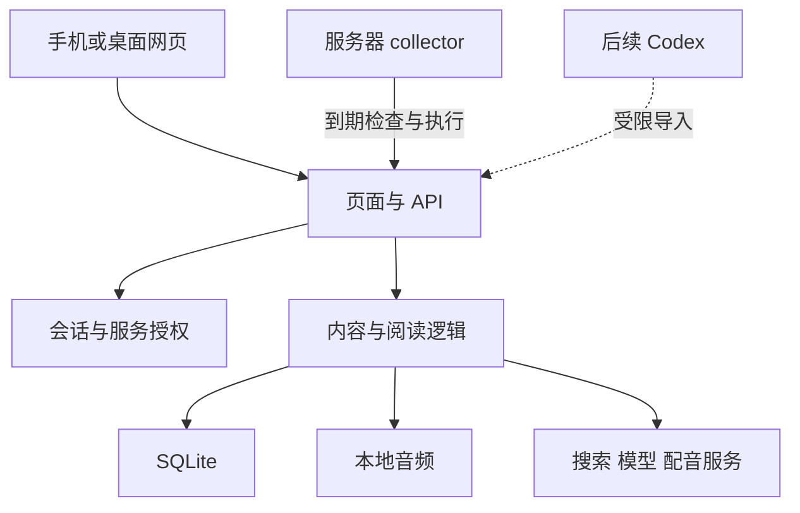

# ARCHITECTURE — 自部署版

更新日期：2026-11-09。此文描述交付目标与代码边界；实际运行验证见 `VERIFICATION.md`，安装命令与环境配置见 `DEPLOYMENT.md`。

## 版本关系

| 项目 | 原托管版快照 | 本目录自部署版 |
| --- | --- | --- |
| Web 运行时 | Vinext / Cloudflare Workers | 标准 Next.js App Router / Node.js 24 |
| 登录 | 托管平台 ChatGPT 身份 | 独立账号、scrypt 密码哈希、签名会话 |
| 业务存储 | D1 | SQLite 文件 |
| 音频 | R2 | `DATA_DIR` 下的本地文件 |
| 后台访问 | 私有站点平台服务身份 | `INGEST_API_TOKEN` Bearer 令牌 |
| 部署 | 原 Sites 工作流 | 单实例 Docker / Node.js，反向代理提供 HTTPS |

原始快照保留追溯关系；它的可信身份头与私有平台访问边界不能直接复制为普通服务器的鉴权方式。

## 结构与数据流

`app/molbrief.tsx` 负责阅读交互，`lib/molbrief-server.ts` 组织检索、摘要、主题和配音，`lib/local-storage.ts` 与 `lib/storage-core.mjs` 隔离数据库与文件访问。浏览器不持有已保存的服务密钥；网页配置只在用户输入时提交新密钥，保存后不回显。日常内容写入与应用源码发布分离。

当前流程：关键词 → NCBI 或明确标注的 Europe PMC MED 题录备用 / Parallel 候选 → 阅读、收藏；配置模型后可生成分段中文解读。已收录资料中的人工实体与事实汇总到 `/knowledge`，可继续通过表单补充来源。页面刷新仅重读存量；collector 按计划新增资料。图中的 Codex 仍为后续接入点。

## 身份与持久化

独立账号内部 ID 固定为 `owner`。密码只保存 scrypt 哈希；签名会话使用独立 `SESSION_SECRET`，Cookie 为 HttpOnly，并按访问地址配置安全属性。`APP_ORIGIN` 用于同源检查。只有有效会话能修改个人收藏、关注与偏好；自带用户 ID 或 ChatGPT 身份头无效。

后台令牌只用于读取内容 / 更新说明及写入材料，不生成个人身份。所有者浏览器与后台任务采用不同的授权范围。当前支持单实例；横向扩展前需要重新评估会话、限流、SQLite 写入和文件共享。

业务数据默认存储于 `DATA_DIR`（默认 `./var`）：SQLite 数据库与音频目录均需持久化。数据库启用 WAL，首次访问自动迁移，`__molbrief_migrations` 记录版本与校验信息；部署镜像必须包含 `drizzle/`。`scripts/backup.mjs` 使用 SQLite 一致性快照，另复制音频和备份清单，不包含 `.env`。恢复时先在独立目录验证，完整步骤见 `DEPLOYMENT.md`。网页服务配置通过 `SESSION_SECRET` 派生的 AES-GCM 密钥加密存入 SQLite；恢复设置必须同时保留原会话密钥，v2 备份清单会标记加密凭据。

## 领域数据

| 对象 / 表 | 关键字段与作用 |
| --- | --- |
| Article / `articles` | `id`、唯一规范化 URL、JSON `payload`、采集时间；正文模型见下文 |
| `reading_state` | `user_id + article_id` 联合主键，分别保存 `saved` 与 `read` |
| `topics` | 名称、检索式、`core / explore`、推荐理由、建立与到期时间 |
| `preferences` | 账号对应的 JSON：声音、语速、朗读方式、自动试用主题等 |
| `audio_assets` | 内容 / 音色哈希 ID、本地音频键、生成时间 |
| `service_settings` | 单所有者的加密配置与绑定当前配置指纹的验证记录；响应不回传密钥 |
| `runs` | 任务 ID、类型、状态、启动时间、详情；当前主要用于配音并发锁 |
| `collection_state / collection_runs` | 每日计划、队列、游标、心跳与租约；逐轮安全日志及完成数量 |
| `collection_usage / collection_cache / collection_backoff` | 北京日界付费次数、查询指纹缓存与来源退避时间 |
| `summary_jobs` | 单篇手动解读的持久队列、快照、状态和租约；同一文章只允许一个活跃任务 |

Article 包含 `title`、可选 `originalTitle`、`category`、`publishedAt`、`url`、`source`、`type`、`summary`、`keyPoints`、`limitations`、`topics`、`readingBasis`、`group`、`collectedAt` 与可选 `coverSource`。可选的 `deepDive` 保存六类深读，`entities` 保存药物 / 靶点 / 公司 / 合作与逐条来源事实；`sourceText` 是原始摘录，`sourceReview` 记录核对范围和时间。`publishedAt` 与 `collectedAt` 含义不同；无法确认精确发表日期时保留 `null`。

URL 去除已知追踪参数与片段后生成稳定 ID，相同 URL 更新既有材料；尚无事件级语义去重。查询合并 seed 与完整已收录集合，较早且未收藏的证据也不会被 200 条截断。实体按人工确认的名称 / 别名合并；旧名称生成的专题链接继续可用。收藏已有记录不覆盖编辑内容，导入与解读回写均合并数据库当前证据，包含同批重复 URL 的追加。探索主题默认 14 天、最多 10 个，全部关注最多 40 个。

## API 约定

所有路径以 `/api` 开头，普通业务使用 JSON；参数限制以路由和 Zod schema 为准。

| 方法与路径 | 用途 | 自部署授权 |
| --- | --- | --- |
| POST / DELETE `/session` | 登录 / 退出；POST 也支持退出动作 | 登录入口校验账号，退出清除会话 |
| GET `/health` | 最小健康状态 | 公开，不返回个人数据 |
| GET `/feed` | 已收录内容 | 会话或服务令牌 |
| GET `/knowledge` | 带来源事实与时间线的专题目录 | 会话 |
| GET / POST `/settings` | 读取非秘密配置、保存与显式验证服务 | 会话，同源写入 |
| GET / POST `/collection` | 采集状态、计划和手动入队 | 会话，同源写入 |
| POST `/collection/tick` | 唤醒到期或排队工作 | 仅服务令牌，同源 Origin |
| POST `/article` | 手工资料与实体事实补充 | 会话，同源写入 |
| GET `/state` | 收藏、已读、主题、偏好与配置状态 | 会话 |
| GET `/update-guide` | 后台更新规则与关注方向 | 会话或服务令牌 |
| POST `/ingest` | 校验并批量写入文章，按 URL 合并 | 服务令牌 |
| POST `/reading` | 设置收藏或已读 | 会话 |
| POST `/topics` | 新增、移除、转长期、修改检索式 | 会话 |
| POST `/preferences` | 更新声音和探索偏好 | 会话 |
| POST `/search` | PubMed 或 Parallel 搜索 | 会话 |
| POST `/collect` | 收录并收藏候选 | 会话 |
| POST `/summarize` | 保存候选并排队单篇解读，返回 202 和任务 ID | 会话及模型配置 |
| GET `/summary-status/{id}` | 读取任务进度 / 安全错误，完成后返回文章 | 仅会话 |
| POST `/audio` | 为已收录文章生成音频 | 会话及配音配置 |
| GET `/audio/{id}` | 读取音频文件 | 会话 |

导入请求形如 `{"articles":[...Article字段...]}`，单次最多 30 条。服务调用使用 `Authorization: Bearer <INGEST_API_TOKEN>`，令牌从运行时环境读取，不写入调度提示词、Git 或日志。后台任务写入后应通过 `/feed` 读回；不能仅依赖返回条数。

## 外部能力与扩展边界

文献搜索优先使用 NCBI 题录与摘要接口。当前 ECS 出口被 NCBI 限制时，使用官方 Europe PMC 的 MED 记录作为备用，标明提供方且保留真实 PMID 的 PubMed 链接；未知精确日期保持 `null`，尊重上游 Retry-After，不循环重试受限接口。Parallel 当前读取搜索摘录；兼容模型接口按材料输出中文结构化解读；MiniMax 通过预先配置的音色生成 MP3。配音按文本、音色和模型生成缓存键，并使用数据库锁降低并发重复生成风险。配置项存在只表示已配置，真实可用性需调用验证。

全文采集、来源快照与事件合并应在这些边界上逐步增加。保留统一 Article 数据结构。PWA 当前缓存图标和断网提示，不缓存完整私人阅读库；设备朗读与浏览器后台播放能力也不等同于完整音频 App。

## 自动采集

`collector` 与 `app` 使用同一镜像中的独立 Node 进程。采集进程不挂载数据库、不开端口，也不持有模型或搜索 API 密钥；仅通过固定内部地址向 `POST /api/collection/tick` 发送后台令牌。应用检查每日北京时间计划和手动队列后执行工作，状态、预算、缓存、游标和租约均存 SQLite。新迁移为 `0002_auto_collection.sql`。

所有者通过 `GET / POST /api/collection` 查看记录、修改设置或排队；服务令牌不能管理这些设置，普通会话不能执行 tick。检索直接复用现有来源与模型适配，未配置或未勾选的付费能力不会调用。付费次数在调用前预留，失败也计入每日上限；并发运行使用数据库租约隔离，异常中断可以恢复。

已有 URL 在模型调用前去重，写入使用 `INSERT OR IGNORE`，不覆盖人工扩写、来源事实、收藏或已读。新条目保留原始摘要 / 搜索摘录的阅读范围；没有生成中文或提取全文时不会标为已完成。首页轮询采集状态，发现新完成记录后读取更新内容。它是关注关键词采集，不是完整事件合并或自主专题研究。

补全旧文章使用独立 summarize 模式，不执行检索；遵守本次篇数、每轮和每日自动模型次数上限，条件写入跳过生成期间已被修改的原文 / 标题 / 摘要。单篇手动解读进入 `summary_jobs`，先于下一轮采集执行，客户端只发短状态请求；worker 使用数据库门限串行处理单篇和采集任务。手动单篇是明确的一次模型调用，不计入自动任务每日次数，界面单独说明。中断的单篇任务租约过期后标失败，不自动再次计费。

模型请求按官方主机与已知模型限定兼容参数；读取 SSE 时只累计最终答案，忽略 reasoning_content。完整输出经过来源白名单和结构校验后才写入，网页请求不再承担等待模型生成的长连接。

## 靶点研究与日期口径（2026-11-09）

`GET /api/target-research?q=...` / `?id=...` 仅 owner 会话可调用，服务令牌不能代替登录。`lib/target-research.ts` 只访问固定 Open Targets HTTPS GraphQL 地址，变量化查询、标准 Ensembl ID 校验、超时 / 响应大小 / 并发限制、限流等待和一小时有界缓存。页面位于 `app/target-panel.tsx`，入口 `/targets`；外部查询不写入领域事实，关注沿用 topics，显式中文解读沿用 article 与 summary_jobs。接口响应保留官方来源和读取时间，不将读取日作为发表日。

`lib/publication-date.mjs` 统一北京日界、精确日和未来日期处理。论文适配优先电子发表，期刊原始卷期保存在 `publicationInfo`。feed 再次屏蔽未来已发表日期；入库同样规范化。历史日期修复按源记录核对，SQLite 备份及 payload 条件写入防止覆盖并发编辑。模型只能回写编辑内容，不改变这些日期元数据。`summaryReview` 记录解读版本、生成时间与原始摘录 / 已有整理材料的范围。
