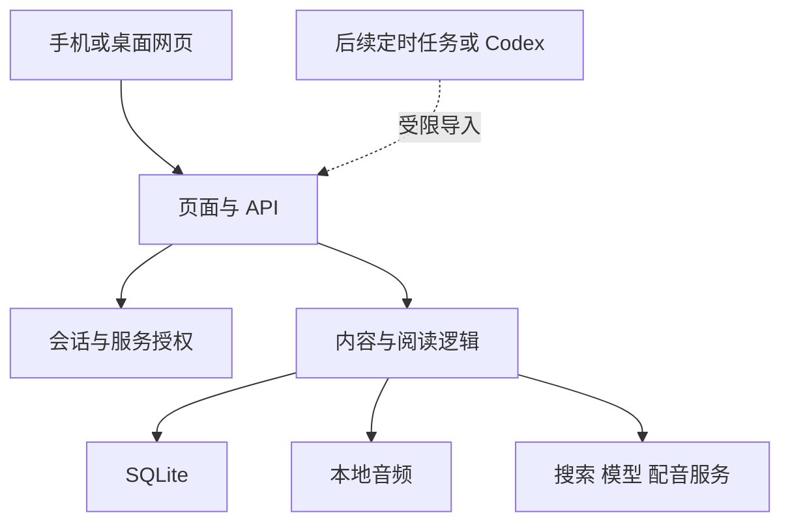

# ARCHITECTURE — 自部署版

日期：2026-10-27。此文描述交付目标与代码边界；实际运行验证见 `VERIFICATION.md`，安装命令与环境配置见 `DEPLOYMENT.md`。

## 版本关系

| 项目 | 原托管版快照 | 本目录自部署版 |
| --- | --- | --- |
| Web 运行时 | Vinext / Cloudflare Workers | 标准 Next.js App Router / Node.js 24 |
| 登录 | 托管平台 ChatGPT 身份 | 独立账号、scrypt 密码哈希、签名会话 |
| 业务存储 | D1 | SQLite 文件 |
| 音频 | R2 | `DATA_DIR` 下的本地文件 |
| 后台访问 | 私有站点平台服务身份 | `INGEST_API_TOKEN` Bearer 令牌 |
| 部署 | 原 Sites 工作流 | 单实例 Docker / Node.js，反向代理提供 HTTPS |

原始快照保留追溯关系；它的可信身份头与私有平台访问边界不能直接复制为普通服务器的鉴权方式。

## 结构与数据流

`app/molbrief.tsx` 负责阅读交互，`lib/molbrief-server.ts` 组织检索、摘要、主题和配音，`lib/local-storage.ts` 与 `lib/storage-core.mjs` 隔离数据库与文件访问。浏览器不持有服务密钥。日常内容写入与应用源码发布分离。

当前流程：搜索返回候选 → 用户阅读 / 收藏；配置模型后可生成中文解读并收录。页面刷新仅重读存量。图中的定时任务与 Codex 是后续接入点，交付时不代表已经启动。

## 身份与持久化

独立账号内部 ID 固定为 `owner`。密码只保存 scrypt 哈希；签名会话使用独立 `SESSION_SECRET`，Cookie 为 HttpOnly，并按访问地址配置安全属性。`APP_ORIGIN` 用于同源检查。只有有效会话能修改个人收藏、关注与偏好；自带用户 ID 或 ChatGPT 身份头无效。

后台令牌只用于读取内容 / 更新说明及写入材料，不生成个人身份。所有者浏览器与后台任务采用不同的授权范围。当前支持单实例；横向扩展前需要重新评估会话、限流、SQLite 写入和文件共享。

业务数据默认存储于 `DATA_DIR`（默认 `./var`）：SQLite 数据库与音频目录均需持久化。数据库启用 WAL，首次访问自动迁移，`__molbrief_migrations` 记录版本与校验信息；部署镜像必须包含 `drizzle/`。`scripts/backup.mjs` 使用 SQLite 一致性快照，另复制音频和备份清单，不包含 `.env`。恢复时先在独立目录验证，完整步骤见 `DEPLOYMENT.md`。

## 领域数据

| 对象 / 表 | 关键字段与作用 |
| --- | --- |
| Article / `articles` | `id`、唯一规范化 URL、JSON `payload`、采集时间；正文模型见下文 |
| `reading_state` | `user_id + article_id` 联合主键，分别保存 `saved` 与 `read` |
| `topics` | 名称、检索式、`core / explore`、推荐理由、建立与到期时间 |
| `preferences` | 账号对应的 JSON：声音、语速、朗读方式、自动试用主题等 |
| `audio_assets` | 内容 / 音色哈希 ID、本地音频键、生成时间 |
| `runs` | 任务 ID、类型、状态、启动时间、详情；当前主要用于配音并发锁 |

Article 包含 `title`、可选 `originalTitle`、`category`、`publishedAt`、`url`、`source`、`type`、`summary`、`keyPoints`、`limitations`、`topics`、`readingBasis`、`group`、`collectedAt` 与可选 `coverSource`。`publishedAt` 与 `collectedAt` 含义不同；无法确认精确发表日期时保留 `null`。

URL 去除已知追踪参数与片段后生成稳定 ID，相同 URL 更新既有材料；尚无事件级语义去重。查询合并 seed、近期材料和所有者收藏，较旧收藏不能被首页数量限制截掉。探索主题默认 14 天、最多 10 个，全部关注最多 40 个。

## API 约定

所有路径以 `/api` 开头，普通业务使用 JSON；参数限制以路由和 Zod schema 为准。

| 方法与路径 | 用途 | 自部署授权 |
| --- | --- | --- |
| POST / DELETE `/session` | 登录 / 退出；POST 也支持退出动作 | 登录入口校验账号，退出清除会话 |
| GET `/health` | 最小健康状态 | 公开，不返回个人数据 |
| GET `/feed` | 已收录内容 | 会话或服务令牌 |
| GET `/state` | 收藏、已读、主题、偏好与配置状态 | 会话 |
| GET `/update-guide` | 后台更新规则与关注方向 | 会话或服务令牌 |
| POST `/ingest` | 校验并批量写入文章，按 URL 合并 | 服务令牌 |
| POST `/reading` | 设置收藏或已读 | 会话 |
| POST `/topics` | 新增、移除、转长期 | 会话 |
| POST `/preferences` | 更新声音和探索偏好 | 会话 |
| POST `/search` | PubMed 或 Parallel 搜索 | 会话 |
| POST `/collect` | 收录并收藏候选 | 会话 |
| POST `/summarize` | 调用模型并保存解读 | 会话及模型配置 |
| POST `/audio` | 为已收录文章生成音频 | 会话及配音配置 |
| GET `/audio/{id}` | 读取音频文件 | 会话 |

导入请求形如 `{"articles":[...Article字段...]}`，单次最多 30 条。服务调用使用 `Authorization: Bearer <INGEST_API_TOKEN>`，令牌从运行时环境读取，不写入调度提示词、Git 或日志。后台任务写入后应通过 `/feed` 读回；不能仅依赖返回条数。

## 外部能力与扩展边界

PubMed 使用题录与摘要接口；Parallel 当前读取搜索摘录；兼容模型接口按材料输出中文结构化解读；MiniMax 通过预先配置的音色生成 MP3。配音按文本、音色和模型生成缓存键，并使用数据库锁降低并发重复生成风险。配置项存在只表示已配置，真实可用性需调用验证。

全文采集、来源快照、定时任务、调用配额与事件合并应在这些边界上逐步增加。先保留统一 Article 数据结构，不提前拆出多个服务。PWA 当前缓存图标和断网提示，不缓存完整私人阅读库；设备朗读与浏览器后台播放能力也不等同于完整音频 App。
